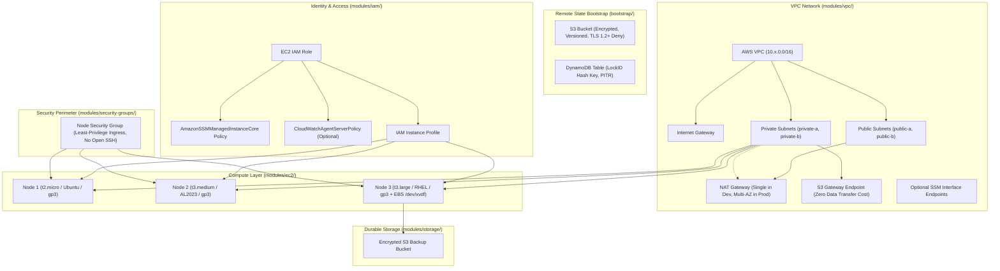

# Enterprise Reusable AWS Infrastructure as Code (IaC) Framework

A production-grade, input-driven, modular AWS Infrastructure as Code framework built with Terraform. Designed for enterprise DevOps and SRE teams to provision, scale, and manage heterogeneous AWS infrastructure across environments (`dev`, `staging`, `prod`) purely by modifying configuration files without altering underlying resource definitions.

---

## Table of Contents
1. [Architecture Overview](#architecture-overview)
2. [Key Architecture Tenets](#key-architecture-tenets)
3. [Repository Structure](#repository-structure)
4. [Input-Driven Infrastructure Model](#input-driven-infrastructure-model)
5. [Resource Lifecycle & Safety Mechanics](#resource-lifecycle--safety-mechanics)
6. [Module Catalog](#module-catalog)
7. [Step-by-Step Deployment Workflow (Steps 1–12)](#step-by-step-deployment-workflow-steps-112)
8. [Configuration Examples](#configuration-examples)
9. [Detailed Input Variable Reference](#detailed-input-variable-reference)
10. [Outputs Reference](#outputs-reference)
11. [Cost Estimation Breakdown](#cost-estimation-breakdown)
12. [Troubleshooting & Runbook](#troubleshooting--runbook)

---

## Architecture Overview



---

## Key Architecture Tenets

1. **Zero Resource Modification**: You never edit `.tf` files in `modules/` to adjust instance counts, change instance types, resize EBS volumes, or add nodes. All changes occur through `.tfvars`.
2. **Stable Identity with `for_each`**: Resources are declared using stable string keys (e.g., `worker-1`, `app-primary`) instead of sequential integer lists (`count`). Adding or removing an instance touches **only that specific instance**, eliminating index-shifting deletions.
3. **Defense in Depth**:
   - **No Open Administrative Ports**: Security groups validate and reject unrestricted ingress on ports `22` (SSH) and `3389` (RDP).
   - **Port-Less Administration via AWS SSM**: Every instance attaches the `AmazonSSMManagedInstanceCore` profile, enabling audited, shell access via AWS Systems Manager Session Manager.
   - **IMDSv2 Enforced**: `http_tokens = "required"` defends against Server-Side Request Forgery (SSRF) attacks.
   - **Mandatory Storage Encryption**: All root and secondary EBS volumes enforce AES-256 encryption. S3 buckets block all public access, enforce SSE, and mandate TLS 1.2+ transport.
4. **Environment Isolation**: Separate Terraform state workspaces and directories for `dev`, `staging`, and `prod`, preventing configuration cross-contamination.

---

## Repository Structure

```text
aws-terraform-framework/
├── .gitignore                      # Ignore credentials, local state, and plan files
├── README.md                       # Complete documentation and architecture manual
├── bootstrap/                      # Separate remote state backend bootstrap
│   ├── main.tf                     # S3 bucket, DynamoDB lock table, TLS bucket policy
│   ├── variables.tf                # Parameterized bucket name, region, KMS
│   ├── outputs.tf                  # Outputs ready-to-paste backend HCL snippet
│   ├── versions.tf                 # Provider constraints
│   └── terraform.tfvars.example    # Sample bootstrap inputs
├── modules/
│   ├── vpc/                        # VPC, subnets, IGW, NAT GW, S3/SSM endpoints
│   │   ├── main.tf
│   │   ├── variables.tf
│   │   ├── outputs.tf
│   │   └── versions.tf
│   ├── iam/                        # EC2 IAM role, SSM policies, instance profile
│   │   ├── main.tf
│   │   ├── variables.tf
│   │   ├── outputs.tf
│   │   └── versions.tf
│   ├── security-groups/            # Least-privilege ingress/egress rules & validation
│   │   ├── main.tf
│   │   ├── variables.tf
│   │   ├── outputs.tf
│   │   └── versions.tf
│   ├── storage/                    # S3 backup bucket, versioning, encryption
│   │   ├── main.tf
│   │   ├── variables.tf
│   │   ├── outputs.tf
│   │   └── versions.tf
│   └── ec2/                        # Input-driven instance provisioning & EBS volumes
│       ├── main.tf
│       ├── ami.tf                  # Dynamic AMI resolution (Ubuntu, AL2023, RHEL, Debian)
│       ├── variables.tf            # Input schema & attribute validations
│       ├── outputs.tf
│       └── versions.tf
├── environments/
│   ├── dev/                        # Development environment deployment
│   │   ├── main.tf                 # Module orchestration
│   │   ├── variables.tf            # Environment-level schema
│   │   ├── outputs.tf              # Environment operational outputs
│   │   ├── versions.tf
│   │   ├── terraform.tfvars        # Active dev configuration
│   │   └── backend.tf.example      # S3 backend template
│   ├── staging/                    # Staging environment deployment
│   │   ├── main.tf
│   │   ├── variables.tf
│   │   ├── outputs.tf
│   │   ├── versions.tf
│   │   ├── terraform.tfvars
│   │   └── backend.tf.example
│   └── prod/                       # Production environment deployment
│       ├── main.tf
│       ├── variables.tf
│       ├── outputs.tf
│       ├── versions.tf
│       ├── terraform.tfvars
│       └── backend.tf.example
├── examples/
│   ├── single-instance/            # 1x t3.micro public bastion
│   │   ├── terraform.tfvars
│   │   └── README.md
│   ├── mixed-instance-types/       # 2x t3.small + 3x t3.medium with heterogeneous OS & EBS
│   │   ├── terraform.tfvars
│   │   └── README.md
│   └── multi-node/                 # 5x t2.micro uniform worker pool
│       ├── terraform.tfvars
│       └── README.md
└── scripts/
    ├── validate.sh                 # Linux/macOS format, lint, and syntax validation
    ├── validate.ps1                # Windows PowerShell validation suite
    ├── deploy.sh                   # Standardized plan & apply pipeline
    └── destroy.sh                  # Controlled teardown with production safeguard
```

---

## Input-Driven Infrastructure Model

### The Problem with Traditional Terraform
In naive Terraform repositories, deploying a new EC2 instance requires copy-pasting an entire `resource "aws_instance" "node_xyz"` block, modifying CIDRs, hardcoding AMI IDs, and updating security group associations.

### The Input-Driven Solution
This framework extracts infrastructure intent into a declarative `map(object({ ... }))` passed into `instances`. Subnets are referenced by intuitive logical names (e.g. `subnet = "private-a"`), which the root environment module automatically maps to actual AWS subnet IDs:

```hcl
instances = {
  # Node 1: Ubuntu worker on private-a
  worker-1 = {
    instance_type  = "t2.micro"
    os             = "ubuntu"
    subnet         = "private-a"
    root_volume_gb = 20
    root_volume_type = "gp3"
    extra_tags = {
      Role = "worker"
    }
  }

  # Node 2: Amazon Linux 2023 with extra storage
  worker-2 = {
    instance_type  = "t3.medium"
    os             = "amazon-linux"
    subnet         = "private-b"
    root_volume_gb = 40
    root_volume_type = "gp3"
  }

  # Node 3: Database node with a dedicated 100 GB secondary volume
  db-primary = {
    instance_type           = "t3.large"
    os                      = "amazon-linux"
    subnet                  = "private-a"
    root_volume_gb          = 50
    disable_api_termination = true
    additional_ebs_volumes = {
      data = {
        device_name = "/dev/xvdf"
        size_gb     = 100
        type        = "gp3"
        encrypted   = true
      }
    }
  }
}
```

### Why `for_each` Instead of `count`?

| Attribute | `count = 5` | `for_each = var.instances` |
| :--- | :--- | :--- |
| **Addressing** | `aws_instance.this[0]`, `aws_instance.this[1]`, etc. | `aws_instance.this["worker-1"]`, `aws_instance.this["worker-2"]` |
| **Removing middle node** | Removing index `1` forces Terraform to **recreate** all subsequent nodes (`2` becomes `1`, `3` becomes `2`). Catastrophic for production state! | Removing `"worker-2"` instructs Terraform to destroy **only** `"worker-2"`. All other instances remain undisturbed. |
| **Heterogeneous attributes** | Requires complex `element()` and `lookup()` matching on parallel lists. | Fully supported: each key carries its own complete, strongly-typed configuration block. |

---

## Resource Lifecycle & Safety Mechanics

Understanding how Terraform and AWS handle configuration changes prevents unintended downtime or data loss:

### 1. In-Place Updates (Zero Resource Recreation)
The following modifications do **NOT** recreate the EC2 instance:
- **Adding/Modifying Tags**: Applied in-place via the AWS API.
- **Modifying Security Groups**: `vpc_security_group_ids` are updated dynamically while the instance is running.
- **Instance Type Resizing**:
  - Changing `instance_type = "t3.micro"` to `"t3.small"` modifies the AWS instance attribute.
  - *Lifecycle behavior*: Terraform initiates a stop, re-sizes the hypervisor instance type, and restarts the instance. This requires brief downtime but preserves all root and attached volume data and private IP addresses.

### 2. Immutable Changes Requiring Instance Replacement
The following changes force Terraform to **destroy and recreate** the instance:
- **Changing `subnet` or `availability_zone`**: An EC2 instance cannot be migrated across subnets or AZs in-place.
- **Changing `ami`**: Operating system changes require spinning up a fresh instance.
- **Shrinking Root EBS Volume Size**: AWS Elastic Block Store allows **expanding** volume sizes on the fly, but **never shrinking**. Decreasing `root_volume_gb` from `40` to `20` forces an EBS volume replacement.

### 3. Safety Controls Implemented
- **`ignore_changes = [ami]`**: Cloud providers regularly issue updated AMI IDs with patched kernels. Without `ignore_changes`, a routine `terraform plan` on an existing stack would propose destroying live servers to align with the newest daily AMI build.
- **`disable_api_termination = true`**: Enforced on production instances to prevent accidental termination via the AWS Console or CLI.
- **`prevent_destroy` in State**: Can be attached to persistent databases or stateful storage.

---

## Module Catalog

### 1. `modules/vpc`
- **CIDR & Subnet Management**: Configurable CIDR with public and private subnet topologies.
- **NAT Gateway Strategies**:
  - `enable_nat_gateway = false`: Cost-optimized for dev (zero hourly NAT fees).
  - `single_nat_gateway = true`: 1 NAT Gateway shared across private subnets (ideal for staging).
  - `single_nat_gateway = false`: High availability, 1 NAT Gateway per Availability Zone (production).
- **VPC Endpoints**:
  - `enable_s3_endpoint = true`: Gateway endpoint attached to route tables for free, direct S3 communication.
  - `enable_ssm_endpoints = true`: Private Interface endpoints (`ssm`, `ssmmessages`, `ec2messages`) for air-gapped VPCs without internet access.

### 2. `modules/ec2`
- **AMI Auto-Discovery**: Dynamically resolves official AMIs for `ubuntu`, `amazon-linux`, `rhel`, and `debian`. Custom AMIs can be provided via `ami_id`.
- **IMDSv2 Enforcement**: `http_tokens = "required"` defends against credential extraction and SSRF vulnerabilities.
- **EBS Encryption**: AES-256 enabled on all root volumes and attached secondary EBS volumes.
- **Detailed Monitoring**: Toggles CloudWatch 1-minute metrics (`enable_monitoring`).

### 3. `modules/security-groups`
- **Least-Privilege Defaults**: Allows internal VPC traffic by default; egress restricted to HTTP/HTTPS for updates.
- **Automated Ingress Validation**: Terraform `validation` block blocks any rule granting port `22` or `3389` to `0.0.0.0/0`.

### 4. `modules/iam`
- **Port-Less Administration**: Automatically attaches `AmazonSSMManagedInstanceCore` to the instance profile.
- **CloudWatch Metrics**: Optional attachment of `CloudWatchAgentServerPolicy`.
- **Custom Policies**: Supports attaching custom inline policies (e.g. S3 backup bucket read/write).

### 5. `modules/storage`
- **S3 Backup Bucket**: Feature-flagged (`enable_backup_bucket`).
- **Data Protection**: Public access block, server-side encryption, versioning, noncurrent version expiration lifecycle rules, and TLS 1.2+ bucket policy.

### 6. `bootstrap`
- **Remote State Foundation**: Creates the dedicated S3 state bucket and DynamoDB locking table (`LockID` string HASH key).

---

## Step-by-Step Deployment Workflow (Steps 1–12)

### Step 1: Install Prerequisites
Ensure Terraform (>= 1.5.0) and AWS CLI (v2) are installed:
```bash
# Verify Terraform version
terraform version

# Verify AWS CLI version
aws --version
```

### Step 2: Authenticate to AWS
Authenticate using AWS IAM Identity Center (SSO), short-term credentials, or named profiles:
```bash
# Option A: AWS SSO
aws sso login --profile my-devops-profile
export AWS_PROFILE=my-devops-profile

# Option B: Verify active caller identity
aws sts get-caller-identity
```

### Step 3: Bootstrap Remote State Infrastructure
Before provisioning application resources, establish the remote state backend:
```bash
cd bootstrap

# Copy sample variables
cp terraform.tfvars.example terraform.tfvars

# Initialize and apply bootstrap
terraform init
terraform plan -out=bootstrap.tfplan
terraform apply bootstrap.tfplan
```
*Note the outputs: `state_bucket_name` and `dynamodb_lock_table_name`.*

### Step 4: Configure the Environment Backend
Navigate to your desired environment (e.g., `environments/dev`):
```bash
cd ../environments/dev

# Create backend.tf from the example template
cp backend.tf.example backend.tf
```
Edit `backend.tf` and fill in the bucket name and lock table outputted in Step 3.

### Step 5: Define Infrastructure Requirements
Review and adjust `terraform.tfvars`. To add, modify, or remove EC2 instances, edit the `instances` block:
```hcl
instances = {
  node-1 = {
    instance_type  = "t2.micro"
    os             = "ubuntu"
    subnet         = "private-a"
    root_volume_gb = 20
  }
}
```

### Step 6: Initialize Terraform
Initialize the environment directory:
```bash
terraform init
```

### Step 7: Format and Validate Configuration
Run syntax and formatting checks:
```bash
# Format check
terraform fmt -check -recursive

# Syntax validation
terraform validate

# Or run the included script
../../scripts/validate.sh
```

### Step 8: Generate and Review the Execution Plan
Always save your plan to an artifact file before applying:
```bash
terraform plan -out=dev.tfplan
```
Inspect the plan output:
- Verify which instances will be created (`+`), modified in-place (`~`), or destroyed (`-`).
- Confirm that no unintended instance replacements are scheduled.

### Step 9: Apply Approved Changes
Apply the exact, reviewed plan file:
```bash
terraform apply dev.tfplan
```

### Step 10: Verify the Provisioned Infrastructure
Inspect the resulting infrastructure via Terraform outputs and the AWS CLI:
```bash
# Display summary of all created instances
terraform output -json instance_summary

# Test connecting to an instance via AWS Systems Manager (no SSH key needed!)
aws ssm start-session --target <INSTANCE_ID>
```

### Step 11: Inspect State Safely
Inspect state without exposing secrets:
```bash
# List all managed resources
terraform state list

# View attributes of a specific instance
terraform state show 'module.ec2.aws_instance.this["node-1"]'
```

### Step 12: Controlled Teardown (Development Environments)
When decommissioning test environments:
```bash
# Review destruction plan
terraform plan -destroy

# Execute controlled teardown
terraform destroy -auto-approve
```
*(Production teardowns are blocked by default in `scripts/destroy.sh` unless `--force-prod` is explicitly supplied).*

---

## Configuration Examples

### Example 1: 5x `t2.micro` Uniform Worker Pool
Located in `examples/multi-node/terraform.tfvars`:
```hcl
instances = {
  worker-1 = { instance_type = "t2.micro", os = "ubuntu", subnet = "private-a", root_volume_gb = 20 }
  worker-2 = { instance_type = "t2.micro", os = "ubuntu", subnet = "private-a", root_volume_gb = 20 }
  worker-3 = { instance_type = "t2.micro", os = "ubuntu", subnet = "private-b", root_volume_gb = 20 }
  worker-4 = { instance_type = "t2.micro", os = "ubuntu", subnet = "private-b", root_volume_gb = 20 }
  worker-5 = { instance_type = "t2.micro", os = "ubuntu", subnet = "private-b", root_volume_gb = 20 }
}
```

### Example 2: 3x `t3.medium` Staging Tier
Located in `environments/staging/terraform.tfvars`:
```hcl
instances = {
  stage-api-1  = { instance_type = "t3.medium", os = "ubuntu", subnet = "private-a", root_volume_gb = 30 }
  stage-api-2  = { instance_type = "t3.medium", os = "ubuntu", subnet = "private-b", root_volume_gb = 30 }
  stage-worker = { instance_type = "t3.medium", os = "amazon-linux", subnet = "private-a", root_volume_gb = 50 }
}
```

### Example 3: 2x `t3.small` and 3x `t3.medium` Mixed Cluster
Located in `examples/mixed-instance-types/terraform.tfvars`:
```hcl
instances = {
  web-small-1  = { instance_type = "t3.small",  os = "ubuntu",       subnet = "private-a", root_volume_gb = 20 }
  web-small-2  = { instance_type = "t3.small",  os = "debian",       subnet = "private-b", root_volume_gb = 25 }
  app-medium-1 = { instance_type = "t3.medium", os = "amazon-linux", subnet = "private-a", root_volume_gb = 40 }
  app-medium-2 = { instance_type = "t3.medium", os = "amazon-linux", subnet = "private-b", root_volume_gb = 40 }
  db-medium-3  = {
    instance_type  = "t3.medium"
    os             = "rhel"
    subnet         = "private-b"
    root_volume_gb = 80
    additional_ebs_volumes = {
      data = { device_name = "/dev/xvdf", size_gb = 50, type = "gp3", encrypted = true }
    }
  }
}
```

---

## Detailed Input Variable Reference

| Variable Name | Type | Default | Description |
| :--- | :--- | :--- | :--- |
| `aws_region` | `string` | `"ap-south-1"` | AWS Region to deploy into. |
| `environment` | `string` | `"dev"` | Target environment: `dev`, `staging`, or `prod`. |
| `vpc_cidr` | `string` | `"10.0.0.0/16"` | Primary IPv4 CIDR block for the VPC. |
| `public_subnets` | `map(object)` | `{}` | Map of public subnets (e.g. `public-a`, `public-b`). |
| `private_subnets` | `map(object)` | `{}` | Map of private subnets (e.g. `private-a`, `private-b`). |
| `enable_nat_gateway` | `bool` | `false` | Provisions NAT Gateways for outbound internet from private subnets. |
| `single_nat_gateway` | `bool` | `true` | When true, provisions 1 shared NAT GW. When false, provisions 1 per AZ. |
| `enable_s3_endpoint` | `bool` | `true` | Provisions a Gateway VPC Endpoint for S3 (zero hourly cost). |
| `enable_ssm_endpoints`| `bool` | `false` | Provisions Interface VPC Endpoints for Systems Manager (air-gapped VPCs). |
| `enable_backup_bucket`| `bool` | `false` | Provisions an encrypted S3 bucket for application backups. |
| `instances` | `map(object)` | `{}` | Core map defining EC2 instances. |
| `instances.*.instance_type` | `string` | *Required* | EC2 instance type (e.g., `t2.micro`, `t3.medium`, `m6i.large`). |
| `instances.*.os` | `string` | `"ubuntu"` | Operating system: `ubuntu`, `amazon-linux`, `rhel`, `debian`, or `custom`. |
| `instances.*.ami_id` | `string` | `null` | Custom AMI ID (mandatory if `os = "custom"`). |
| `instances.*.subnet` | `string` | *Required* | Key of the public or private subnet (e.g., `private-a`). |
| `instances.*.root_volume_gb` | `number` | `20` | Root EBS volume size in GB (validated >= 8). |
| `instances.*.root_volume_type` | `string` | `"gp3"` | EBS volume type: `gp3`, `gp2`, `io2`, `st1`, `sc1`. |
| `instances.*.associate_public_ip_address` | `bool` | `false` | Assigns a public IPv4 address if placed in a public subnet. |
| `instances.*.enable_monitoring` | `bool` | `false` | Enables CloudWatch 1-minute detailed instance monitoring. |
| `instances.*.disable_api_termination` | `bool` | `false` | Protects instances from accidental termination. |
| `instances.*.additional_ebs_volumes` | `map(object)` | `{}` | Secondary EBS volume attachments. |

---

## Outputs Reference

| Output Name | Type | Description |
| :--- | :--- | :--- |
| `vpc_id` | `string` | AWS VPC ID. |
| `vpc_cidr` | `string` | VPC CIDR block. |
| `public_subnets` | `map(string)` | Map of public subnet names to subnet IDs. |
| `private_subnets` | `map(string)` | Map of private subnet names to subnet IDs. |
| `security_group_id` | `string` | Security Group ID assigned to EC2 instances. |
| `iam_role_arn` | `string` | ARN of the IAM role attached to EC2 instances. |
| `iam_instance_profile_name` | `string` | Instance Profile name attached to EC2 instances. |
| `backup_bucket_name` | `string` | S3 Backup bucket name (if enabled). |
| `ec2_instances` | `map(object)` | Full attribute map of all provisioned EC2 instances. |
| `instance_summary` | `map(object)` | Concise summary map (ID, private IP, public IP, AZ, root volume ID). |
| `instance_count` | `number` | Total count of provisioned instances. |

---

## Cost Estimation Breakdown

*Estimated pricing based on standard on-demand AWS rates for Mumbai (`ap-south-1`) and N. Virginia (`us-east-1`):*

| Component | Specification | ap-south-1 Cost / Month | us-east-1 Cost / Month | Notes |
| :--- | :--- | :--- | :--- | :--- |
| `t2.micro` | 1 vCPU, 1 GB RAM | ~$8.47 | ~$8.47 | Free tier eligible (750 hrs/mo) |
| `t3.micro` | 2 vCPU, 1 GB RAM | ~$7.60 | ~$7.60 | Nitro-based, cost-efficient |
| `t3.small` | 2 vCPU, 2 GB RAM | ~$15.18 | ~$15.18 | General-purpose microservices |
| `t3.medium` | 2 vCPU, 4 GB RAM | ~$30.37 | ~$30.37 | Mid-tier workloads |
| `t3.large` | 2 vCPU, 8 GB RAM | ~$60.74 | ~$60.74 | Databases and caches |
| `gp3` Storage | Per GB / Month | $0.08 / GB | $0.08 / GB | Includes 3,000 IOPS & 125 MB/s |
| NAT Gateway | Per Gateway / Month | ~$32.85 + $0.045/GB | ~$32.85 + $0.045/GB | Optional: Disabled in dev to save cost |
| S3 Gateway Endpoint | VPC Endpoint | **$0.00 (FREE)** | **$0.00 (FREE)** | Eliminates NAT data fees for S3 traffic |
| S3 Storage | Standard tier | $0.023 / GB | $0.023 / GB | Backups and artifacts |

### Monthly Cost by Environment Configuration:
- **Dev Configuration** (3 instances: 1x `t2.micro`, 1x `t3.micro`, 1x `t3.medium`, 80 GB total gp3, NO NAT Gateway):
  $$\approx \$8.47 + \$7.60 + \$30.37 + (80 \times \$0.08) \approx \mathbf{\$52.84 / \text{month}}$$
- **Staging Configuration** (3x `t3.medium`, 110 GB gp3, 1 shared NAT Gateway):
  $$\approx (3 \times \$30.37) + (110 \times \$0.08) + \$32.85 \approx \mathbf{\$132.76 / \text{month}}$$
- **Prod High Availability** (3x `t3.medium`, 2x `t3.large`, 420 GB gp3, 3x Multi-AZ NAT Gateways):
  $$\approx (3 \times \$30.37) + (2 \times \$60.74) + (420 \times \$0.08) + (3 \times \$32.85) \approx \mathbf{\$344.74 / \text{month}}$$

---

## Troubleshooting & Runbook

### 1. `UnsupportedAvailabilityZoneException`
- **Symptom**: `Your requested instance type (e.g. t2.micro) is not supported in your requested Availability Zone`.
- **Cause**: Older generation instance types (like `t2.micro`) or specialized GPU types are not available in every AZ of a given region.
- **Resolution**:
  1. Inspect available instance types per AZ using AWS CLI:
     ```bash
     aws ec2 describe-instance-type-offerings --location-type availability-zone --filters "Name=instance-type,Values=t2.micro,t3.micro" --region ap-south-1
     ```
  2. Switch the instance definition in `terraform.tfvars` to a modern nitro instance type (e.g., `t3.micro`), or relocate the subnet assignment to a supported AZ.

### 2. `VcpuLimitExceeded` / Insufficient Account Quota
- **Symptom**: `You have requested more vCPU capacity than your current vCPU limit of X allows`.
- **Cause**: New AWS accounts often start with restrictive On-Demand Standard (A, C, D, H, I, M, R, T, Z) vCPU quotas (e.g. 32 vCPUs).
- **Resolution**:
  1. Check quota via AWS Service Quotas:
     ```bash
     aws service-quotas get-service-quota --service-code ec2 --quota-code L-1216C47A
     ```
  2. Request a quota increase in the AWS Console under Service Quotas -> Amazon EC2 -> Running On-Demand Standard instances.

### 3. State Lock Stuck in DynamoDB (`ConditionalCheckFailedException`)
- **Symptom**: `Error acquiring the state lock: ConditionalCheckFailedException`.
- **Cause**: A prior Terraform process crashed, was forcefully killed (Ctrl+C), or an active plan is running.
- **Resolution**:
  1. Verify no concurrent CI/CD pipeline or engineer is executing `terraform apply`.
  2. Inspect the lock ID in the error message (e.g. `Lock Info: ID: c9d8...`).
  3. Force-unlock the state safely:
     ```bash
     terraform force-unlock <LOCK_ID>
     ```

### 4. Shrinking EBS Volume Error
- **Symptom**: `volume_size must be greater than or equal to previous size`.
- **Cause**: AWS EBS allows increasing storage online without downtime, but never supports reducing volume sizes.
- **Resolution**: Keep `root_volume_gb` equal to or greater than its current size. If downsizing is mandatory, specify a new instance key in `instances` and decommission the old node.

### 5. AWS Systems Manager Session Manager Not Connecting
- **Symptom**: Instance does not appear in `aws ssm describe-instance-information`.
- **Checklist**:
  1. **IAM Role**: Ensure `AmazonSSMManagedInstanceCore` is attached to the instance profile (enabled by default in `modules/iam`).
  2. **Egress Connectivity**: Private instances must be able to reach SSM endpoints. Either:
     - Enable NAT Gateway (`enable_nat_gateway = true`), OR
     - Enable SSM Interface Endpoints (`enable_ssm_endpoints = true`).
  3. **SSM Agent**: Pre-installed by default on Ubuntu 22.04+ and Amazon Linux 2023. Verify agent status if using a custom AMI.

---

## Conclusion
This framework provides a bulletproof foundation for real-world DevOps, Platform Engineering, and SRE environments. By cleanly separating reusable infrastructure definitions (`modules/`) from declarative configuration inputs (`environments/`), teams can provision complex, multi-node topologies across dev, staging, and production in minutes.
